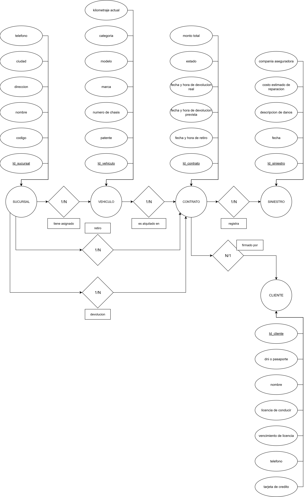

# BASE DE DATOS — Ejercicio 13: Sistema de Gestión de Flotas de Alquiler de Vehículos (Rent a Car)

Trabajo práctico de Base de Datos (Universidad Champagnat). Este repositorio contiene todo el desarrollo del ejercicio 13: modelo entidad-relación, modelo relacional y normalización (1FN, 2FN y 3FN).

## Consigna


#### Contexto

Una compañía internacional de alquiler de automóviles necesita optimizar la operación de sus sucursales distribuidas en aeropuertos y centros urbanos, controlando el inventario de vehículos disponibles, los contratos de alquiler vigentes y la gestión de siniestros o seguros.


#### Consigna

Diseñar el modelo entidad-relación para la empresa de rent a car cumpliendo con las siguientes pautas de negocio:

La empresa opera en múltiples sucursales. De cada sucursal se conoce su código, nombre, dirección y ciudad.

Los vehículos de la flota se identifican por su patente, número de chasis, marca, modelo, categoría (Sedán, SUV, Utilitario, Deportivo), kilometraje actual y la sucursal en la cual se encuentran actualmente asignados.

Los clientes presentan su DNI o pasaporte, nombre, licencia de conducir válida (con fecha de vencimiento), teléfono y tarjeta de crédito registrada.

Se emiten contratos de alquiler. Un contrato registra la fecha y hora de retiro, fecha y hora de devolución prevista, fecha y hora de devolución real, sucursal de retiro, sucursal de devolución, el vehículo alquilado y el cliente responsable.

Durante la vigencia del contrato, el vehículo puede sufrir incidentes o siniestros viales. De cada siniestro se registra la fecha, descripción de los daños, costo estimado de reparación y la compañía aseguradora interviniente.


#### Desarrollo requerido


Identificar las entidades del dominio de alquiler y sus atributos principales.

Modelar la relación entre Sucursal y Vehículo, teniendo en cuenta que un vehículo pertenece operativamente a una sucursal en un momento dado.

Diseñar la entidad Contrato de Alquiler, vinculando al Cliente, al Vehículo y a las Sucursales de origen y destino (utilizando roles o múltiples relaciones foráneas).

Incorporar la entidad Siniestro asociada al Contrato o al Vehículo, asegurando el registro de incidencias.

## Estructura del repositorio

```
BASE_DE_DATOS_Ejercicio_13/
├── README.md
├── modelo-er/
│   ├── ejercicio_13.drawio        # diagrama editable (draw.io)
│   └── ejercicio_13.png           # exportación del diagrama
├── modelo-relacional/
│   ├── ejercicio_13_MR.xlsx               # modelo relacional
│   └── ejercicio_13_con_datos.xlsx        # modelo relacional con datos de ejemplo
└── normalizacion/
    ├── ejercicio_13_1FN.xlsx
    ├── ejercicio_13_2FN.xlsx
    └── ejercicio_13_3FN.xlsx
```

## Modelo entidad-relación



Archivo editable: [`modelo-er/ejercicio_13.drawio`](modelo-er/ejercicio_13.drawio).

## Modelo relacional

Tablas del modelo relacional original, antes de normalizar (`(PK)` clave primaria, `(FK)` clave foránea, `(UNIQUE)` valor único):

- **SUCURSAL**: `Id_sucursal(PK)`, `codigo(UNIQUE)`, `nombre`, `direccion`, `ciudad`, `telefono`
- **VEHICULO**: `Id_vehiculo(PK)`, `patente(UNIQUE)`, `numero de chasis(UNIQUE)`, `marca`, `modelo`, `categoria`, `kilometraje actual`, `Id_sucursal(FK)`
- **CLIENTE**: `Id_cliente(PK)`, `dni o pasaporte(UNIQUE)`, `nombre`, `licencia de conducir`, `vencimiento de licencia`, `telefono`, `tarjeta de credito`
- **CONTRATO**: `Id_contrato(PK)`, `fecha y hora de retiro`, `fecha y hora de devolucion prevista`, `fecha y hora de devolucion real`, `estado`, `monto total`, `Id_vehiculo(FK)`, `Id_cliente(FK)`, `Id_sucursal_retiro(FK)`, `Id_sucursal_devolucion(FK)`
- **SINIESTRO**: `Id_siniestro(PK)`, `fecha`, `descripcion de danos`, `costo estimado de reparacion`, `compania aseguradora`, `Id_contrato(FK)`

Archivos: [`ejercicio_13_MR.xlsx`](modelo-relacional/ejercicio_13_MR.xlsx) y [`ejercicio_13_con_datos.xlsx`](modelo-relacional/ejercicio_13_con_datos.xlsx).

## Lógica relacional

Cada entidad se convierte en una tabla con su clave primaria. Las relaciones se representan así:

- **1:N / N:1**: la clave primaria del lado "uno" se copia como clave foránea (FK) en la tabla del lado "muchos".
- **1:1**: igual que 1:N, pero la FK lleva restricción UNIQUE.
- **N:M**: se crea una tabla intermedia cuyas FK forman una clave compuesta, junto con una clave propia que se identifica por esa combinación.

Relaciones del modelo final (3FN):

- `VEHICULO` → `MODELO`: **N:1** (FK `id_modelo` en `VEHICULO`).
- `VEHICULO` → `SUCURSAL`: **N:1** (FK `id_sucursal` en `VEHICULO`).
- `CONTRATO` → `VEHICULO`: **N:1** (FK `id_vehiculo` en `CONTRATO`).
- `CONTRATO` → `CLIENTE`: **N:1** (FK `id_cliente` en `CONTRATO`).
- `CONTRATO` → la entidad referida por `id_sucursal_retiro`: **N:1** (FK `id_sucursal_retiro` en `CONTRATO`).
- `CONTRATO` → la entidad referida por `id_sucursal_devolucion`: **N:1** (FK `id_sucursal_devolucion` en `CONTRATO`).
- `SINIESTRO` → `CONTRATO`: **N:1** (FK `id_contrato` en `SINIESTRO`).

## Normalización

Los cambios se muestran etapa por etapa; cada etapa parte del resultado de la anterior.

### Primera forma normal (1FN)

- `SUCURSAL`: se quitan `direccion`
- `SUCURSAL`: se agregan `calle`, `numero`
- `CLIENTE`: se quitan `dni o pasaporte`, `tarjeta de credito`
- `CLIENTE`: se agregan `tipo de documento`, `numero de documento`, `marca de tarjeta`, `ultimos 4 digitos de la tarjeta`

### Segunda forma normal (2FN)

Sin cambios respecto de la etapa anterior: el modelo ya cumplía esta forma normal.

### Tercera forma normal (3FN)

- Tablas nuevas: `MODELO`
- `VEHICULO`: se quitan `marca`, `modelo`, `categoria`
- `VEHICULO`: se agregan `id_modelo`

#### Modelo final en 3FN

- **SUCURSAL**: `Id_sucursal(PK)`, `codigo(UNIQUE)`, `nombre`, `calle`, `numero`, `ciudad`, `telefono`
- **VEHICULO**: `Id_vehiculo(PK)`, `patente(UNIQUE)`, `numero de chasis(UNIQUE)`, `Id_modelo(FK)`, `kilometraje actual`, `Id_sucursal(FK)`
- **MODELO**: `Id_modelo(PK)`, `marca(UK1)`, `modelo(UK1)`, `categoria`
- **CLIENTE**: `Id_cliente(PK)`, `tipo de documento(UK1)`, `numero de documento(UK1)`, `nombre`, `licencia de conducir`, `vencimiento de licencia`, `telefono`, `marca de tarjeta`, `ultimos 4 digitos de la tarjeta`
- **CONTRATO**: `Id_contrato(PK)`, `fecha y hora de retiro`, `fecha y hora de devolucion prevista`, `fecha y hora de devolucion real`, `estado`, `monto total`, `Id_vehiculo(FK)`, `Id_cliente(FK)`, `Id_sucursal_retiro(FK)`, `Id_sucursal_devolucion(FK)`
- **SINIESTRO**: `Id_siniestro(PK)`, `fecha`, `descripcion de danos`, `costo estimado de reparacion`, `compania aseguradora`, `Id_contrato(FK)`

Archivos: [`ejercicio_13_1FN.xlsx`](normalizacion/ejercicio_13_1FN.xlsx), [`ejercicio_13_2FN.xlsx`](normalizacion/ejercicio_13_2FN.xlsx), [`ejercicio_13_3FN.xlsx`](normalizacion/ejercicio_13_3FN.xlsx).
